<picture>
  <source media="(prefers-color-scheme: dark)" srcset="docs/assets/wordmark-dark.svg">
  
</picture>

**English** · [日本語](README.ja.md)

**A Japanese input method for macOS that lets you type English without switching modes.**

Kana-kanji conversion is written in Rust and runs entirely on your Mac. What you type stays there.

<table>
  <tr>
    <td align="center" valign="top" width="33%">
      <br>
      <b>Convert</b><br>
      <sub>Space to convert, Enter to commit.</sub>
    </td>
    <td align="center" valign="top" width="33%">
      <br>
      <b>English as you type it</b><br>
      <sub>English words stay English. Space is a space.</sub>
    </td>
    <td align="center" valign="top" width="33%">
      <br>
      <b>Mixed</b><br>
      <sub>Type artifactを使う in one go.</sub>
    </td>
  </tr>
</table>

- **Conversion.** Space converts, and pressing it again moves to the next candidate. Number keys pick one. Enter commits exactly what is shown. The romaji table is the same as Google Japanese Input (Mozc).
- **English.** English words that cannot become kana stay in English letters (enter, merge). Space in the middle of English inserts a space. A word you have committed as English shows up in English from then on (git).
- **Candidates.** English words for katakana loanwords (デスクトップ → desktop) and emoji (ねこ → 🐈).
- **Learning.** The candidates you pick come first next time. Nothing is learned in password fields or password managers.
- **Re-ranking.** A small Japanese language model (rinna japanese-gpt2-xsmall) runs on your Mac and re-orders the full-sentence candidates so the natural one comes first. There is no network access. It adds about 140 MB of memory (peak about 181 MB instead of 41 MB, measured with `/usr/bin/time -l` on a long headless input), takes about 8 ms per decision at the median, and needs the model files (see below); without them the engine's own order is used.
- **Live conversion (optional).** Shows the converted text as you type. Toggle it from the input menu.

## Install

Requirements: macOS 26 or later, Apple Silicon (M1 or later). Intel Macs are not supported.

Install it in one of two ways (available from v0.1.0):

- Homebrew: `brew install --cask n-seiji/tap/novakey-r`
- Or download the zip from Releases with a browser, unzip it in Finder, and move `NovakeyR.app` to `~/Library/Input Methods`.

Then add NovakeyR in System Settings > Keyboard > Input Sources. You may need to log out and back in first.

### Uninstall

First remove NovakeyR from Input Sources. Then, if you installed with Homebrew, run `brew uninstall --zap --cask novakey-r`. If you installed from the zip, delete `~/Library/Input Methods/NovakeyR.app`.

### Build from source

Needs [mise](https://mise.jdx.dev/) and Rust. Re-ranking needs model files, which are not in the repository. Build them once (downloads about 41 MB from Hugging Face; [uv](https://docs.astral.sh/uv/) is installed by mise), then install. You can skip the first step and get the engine's own order.

```sh
mise run judge-model
mise run install
```

This installs `~/Library/Input Methods/NovakeyR.app`. Log out and back in, then add NovakeyR in System Settings > Keyboard > Input Sources.

## No network at runtime

NovakeyR opens no network connections. `scripts/check-no-network.sh` checks the sources and the built binary for network use, and CI runs it on every push and pull request. This is a guarantee about runtime: the judge model is fetched once, at build time. You can also check yourself by reading the sources and looking at `Cargo.lock` for the crates it links.

## Keys

| Key | What it does |
|---|---|
| Space | Convert / next candidate. A plain space in the middle of English |
| Shift+Space | Previous candidate. Converts in the middle of English |
| ↑ ↓ | Move through candidates |
| 1–9 | Pick a candidate and commit |
| Enter | Commit exactly what is shown |
| Esc / Backspace | Cancel the conversion |
| Ctrl+J / K / L / ; / : | Hiragana / katakana / full-width alphanumeric / half-width katakana / half-width alphanumeric |
| F6–F10 | Same as above |

## Where data lives

Learning is stored in `~/Library/Application Support/NovakeyR/rust-learning/` (`learning.tsv` and `english.txt`). Run `mise run reset-memory` to erase it. The key-event trace is off by default, and it never records what you type.

## Releasing

For maintainers. Releases are built, signed and notarized by `.github/workflows/release.yml`; nothing is published until the `release` environment is approved.

1. Once, in this order (the order matters: with the variable set before the environment and its reviewer exist, a release would be published without anyone approving it):
   1. Run `scripts/setup-release-env.sh`. It creates both environments, `signing` (holds the secrets, main only) and `release` (one required reviewer, main only).
   2. Set the five secrets in the `signing` environment (`gh` prompts for the value of the ones without stdin):
      ```sh
      base64 -i cert.p12 | gh secret set DEVELOPER_ID_P12_BASE64 --env signing
      gh secret set DEVELOPER_ID_P12_PASSWORD --env signing
      gh secret set ASC_KEY_ID --env signing
      gh secret set ASC_ISSUER_ID --env signing
      base64 -i AuthKey_XXXXXXXXXX.p8 | gh secret set ASC_KEY_P8_BASE64 --env signing
      ```
   3. Set the repository variable that turns releases on: `gh variable set RELEASE_ENABLED --body true`. Until it is `true`, the workflow only reports "release disabled" and builds nothing, so merging to main is safe.

   The secrets are scoped to the `signing` environment, which only jobs running on main can use, so workflows on other branches cannot read them. Use a dedicated App Store Connect API key for this repository, with the Developer role, for notarization.
2. Bump `version` in `Cargo.toml` and merge to main. The workflow builds the app, signs it, notarizes and staples it, and creates a draft release with `NovakeyR-<version>.app.zip` and its `.sha256`.
3. Test the draft before approving it:
   - Download the zip from the draft **in Safari**, so it gets the quarantine attribute. Unzip it in Finder, move `NovakeyR.app` to `~/Library/Input Methods`, log out and back in, add the input source and type.
   - Repeat with Homebrew. The draft's URL is not public, so copy `packaging/homebrew/novakey-r.rb`, set `url "file:///<path to the downloaded zip>"` and that zip's sha256, and put the copy in a local tap (`brew tap-new --no-git <you>/local`, then its `Casks/`), because Homebrew only installs casks from a tap. Install it with `brew install --cask <you>/local/novakey-r` and check `xattr -p com.apple.quarantine ~/Library/Input\ Methods/NovakeyR.app`.
   - If Gatekeeper blocks the IME, do not approve.
4. Approve the `release` environment. The publish job checks the draft against the build's checksums, attests the zip and publishes the release.
5. Run `scripts/bump-cask.sh <version> <tap>/Casks/novakey-r.rb` (it verifies the checksum and the attestation) and push the tap.

## Credits

- Kana-kanji conversion (`src/kkc/`) is a Rust port of [AzooKeyKanaKanjiConverter](https://github.com/azooKey/AzooKeyKanaKanjiConverter) (MIT, © 2023 Miwa / Ensan).
- The conversion dictionary (`dictionary/`) is data from [azooKey_dictionary_storage](https://github.com/ensan-hcl/azooKey_dictionary_storage) (Apache-2.0).
- The romaji table (`src/romaji_table.tsv`) is [Mozc](https://github.com/google/mozc)'s `romanji-hiragana.tsv` (BSD-3-Clause, © Google Inc.).
- English words for loanwords (`resources/loanwords.tsv`) are built from [EDRDG](https://www.edrdg.org/)'s JMdict (CC BY-SA 4.0).
- Emoji (`resources/emoji.tsv`) are built from Unicode emoji data and CLDR Japanese annotations (Unicode License v3) via [azooKey_emoji_dictionary_storage](https://github.com/ensan-hcl/azooKey_emoji_dictionary_storage).
- Re-ranking uses [rinna/japanese-gpt2-xsmall](https://huggingface.co/rinna/japanese-gpt2-xsmall) (MIT, © rinna Co., Ltd.), converted by `tools/gen_judge_model.py` and not included in this repository.
- The wordmark is outlined from [Newsreader](https://github.com/productiontype/Newsreader) (SIL Open Font License 1.1).

Full license texts are in [`NOTICE`](NOTICE) and [`dictionary/NOTICE`](dictionary/NOTICE).

## License

GPL-3.0-or-later. See [`LICENSE`](LICENSE). Third-party notices are in [`NOTICE`](NOTICE), and the licenses of the Rust crates are in [`THIRD_PARTY_LICENSES`](THIRD_PARTY_LICENSES).
